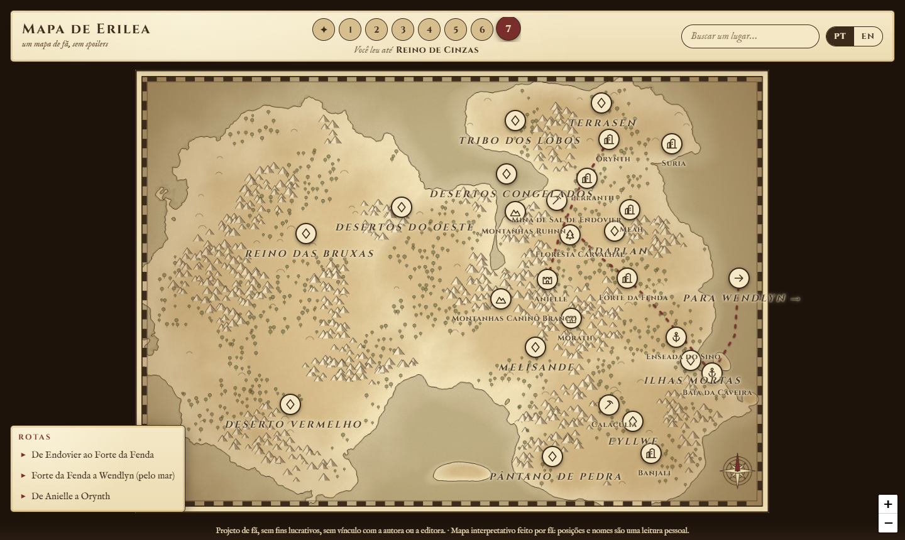
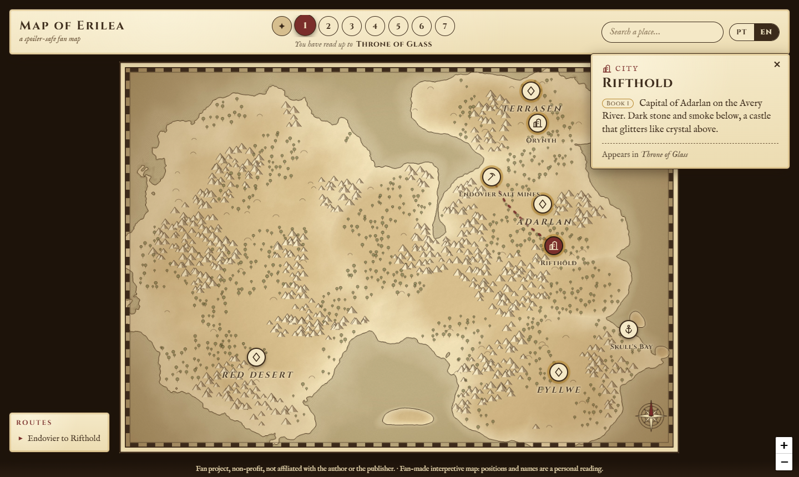
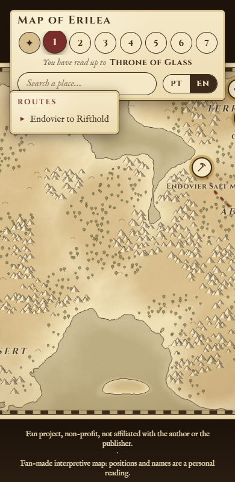

<div align="center">

# 🗺️ Mapa de Erilea · Map of Erilea

**Um mapa interativo de fã, em pergaminho, que só mostra o que você já leu.**
*A fan-made, spoiler-safe interactive parchment map.*




</div>

> **PT** · Projeto de fã (saga *Trono de Vidro*), sem fins lucrativos e sem vínculo com a autora ou a editora. Nenhum trecho dos livros e nenhuma arte oficial são usados: textos escritos por mim, mapa gerado por código.
>
> **EN** · Fan project (*Throne of Glass* saga), non-profit and not affiliated with the author or publisher. No book excerpts and no official art: texts are original and the map is generated by code.

## ✨ Funcionalidades · Features

- **Trava de spoiler por livro** — escolha até onde leu (do prelúdio ao livro 7); lugares, rotas e notas futuras somem. *Pick how far you've read; later places, routes and notes disappear.*
- **Notas em camadas** — um lugar revela mais a cada livro. *A place reveals more with each book.*
- **PT / EN** com troca instantânea, sem recarregar. *Instant language switch.*
- **Rotas animadas** de viagem sobre o mapa. *Animated journey routes.*
- **Busca** que voa até o lugar (só acha o que já está liberado). *Fly-to search, spoiler-aware.*
- **Link que lembra tudo** — `?livro=3&lang=pt&lugar=rifthold`. *Shareable state in the URL.*
- **Pergaminho gerado por código**: costa em tinta, hachuras de mar, cadeias de montanhas, bosques, moldura e bússola, sem nenhum texto na imagem (por isso o mesmo mapa serve aos dois idiomas).
- Responsivo, com foco por teclado e `prefers-reduced-motion`.

<p align="center">
  
  
</p>

## 🧰 Stack

| Camada | Tecnologia | Por quê |
|---|---|---|
| Interface | **Vue 3** (`<script setup>`) + **TypeScript** + **Vite** | Composition API, build rápido |
| Estado | **Pinia** | livro, idioma, lugar aberto |
| Idiomas | **vue-i18n** | PT/EN em tempo real |
| URL | **vue-router** | estado compartilhável via query |
| Mapa | **Leaflet** com `L.CRS.Simple` | mapa de imagem, não de mundo real |
| Arte | Canvas 2D + **simplex-noise** | terra procedural original |
| Testes | **Vitest** | a regra de spoiler é a que não pode errar |
| Deploy | **Netlify** (estático) | `netlify.toml` incluso |

## 🚀 Como rodar

```bash
npm install
npm run dev      # http://localhost:5173
npm test         # regra de spoiler (Vitest)
npm run build    # type-check + build de produção
```

## 🧱 Estrutura

```
src/
  components/   MapaView, BookSelector, PlaceCard, SearchBox, RouteControls, LangToggle, AppFooter
  data/         livros.json · lugares.json · rotas.json
  i18n/         pt.ts · en.ts
  lib/          spoiler.ts (+ testes) · terreno.ts · icons.ts · urlState.ts
  stores/       app.ts (Pinia)
  styles/       tokens.css · parchment.css
  views/        HomeView.vue
```

## ➕ Como adicionar um lugar

Edite [`src/data/lugares.json`](src/data/lugares.json). `livro` é o primeiro livro em que o lugar aparece; cada nota só é exibida a partir do seu próprio `livro`. Posição `x`/`y` entre 0 e 1 sobre a imagem.

```json
{
  "id": "cidade-exemplo", "x": 0.42, "y": 0.31, "tipo": "cidade", "livro": 1,
  "nome": { "pt": "Nome em português", "en": "Name in English" },
  "notas": [
    { "livro": 1, "pt": "Seguro para quem leu até o livro 1.", "en": "Safe up to book 1." },
    { "livro": 4, "pt": "Acrescenta o que muda no livro 4.", "en": "Adds what changes in book 4." }
  ]
}
```

Tipos: `cidade`, `fortaleza`, `floresta`, `montanha`, `regiao`, `porto`, `mina`.

## 🗺️ Roadmap

- [x] **Fase 1 — O mapa vivo**: pergaminho, 27 lugares, seletor de livro, PT/EN
- [x] **Fase 2 — Rotas e viagem**: 3 rotas com animação
- [x] **Fase 3 — Mimos (parte)**: busca e link compartilhável
- [ ] Anotações pessoais (guardadas no navegador) e som ambiente opcional
- [ ] Trocar o terreno procedural pela arte desenhada à mão (tiles)
- [x] Posições e nomes conferidos com o mapa impresso da edição brasileira (Forte da Fenda, Canino Branco…)
- [ ] Conferir **em qual livro cada lugar aparece** (a trava de spoiler é palpite) e as leituras incertas do mapa
- [ ] Preencher a metade oeste (Terras Desérticas, Areias Cantantes…) e o continente do sul (Antica), que não está no mapa impresso
- [ ] Modo escuro "à luz de vela"

## ⚠️ Aviso sobre o conteúdo

As **posições** seguem o mapa impresso da edição brasileira e os **nomes** são os dessa edição (ex.: Rifthold = *Forte da Fenda*). A costa, porém, é gerada por código, não decalcada. O livro em que cada lugar aparece ainda é uma estimativa; a ordem do seletor segue a de publicação. Wendlyn não existe no mapa: só há uma seta "Para Wendlyn" no leste. Cuidado com spoilers escondidos em frases curtas: a nota do livro 1 não pode antecipar o livro 5.

## 📄 Licença

Código sob MIT (ver `LICENSE`). Textos e imagens do projeto pertencem à autora do projeto de fã; *Throne of Glass* e Erilea pertencem a Sarah J. Maas e aos seus editores.
